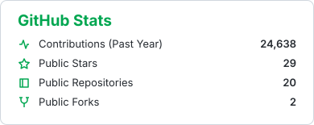
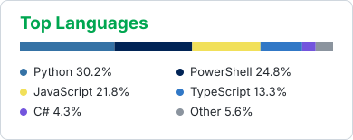

你好 👋 我是电子雪貂饲养员。 
我在完善我的 [personal agents](https://wly0829.cn/)

  <picture>
    <source media="(prefers-color-scheme: dark)" srcset="https://raw.githubusercontent.com/wlyaaaaa/wlyaaaaa/output/github-contribution-grid-snake-dark.svg?v=loop-20261005">
    
  </picture>

  <picture>
    <source media="(prefers-color-scheme: dark)" srcset="https://raw.githubusercontent.com/wlyaaaaa/wlyaaaaa/output/profile-stats-dark.svg">
    
  </picture>
  <picture>
    <source media="(prefers-color-scheme: dark)" srcset="https://raw.githubusercontent.com/wlyaaaaa/wlyaaaaa/output/profile-languages-dark.svg">
    
  </picture>

